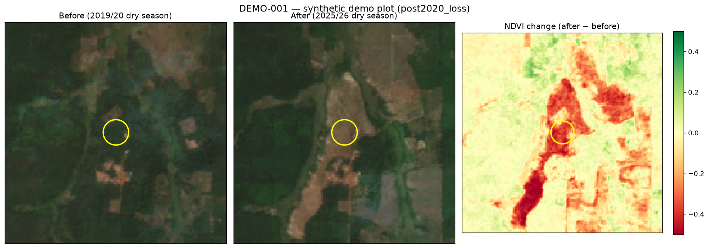
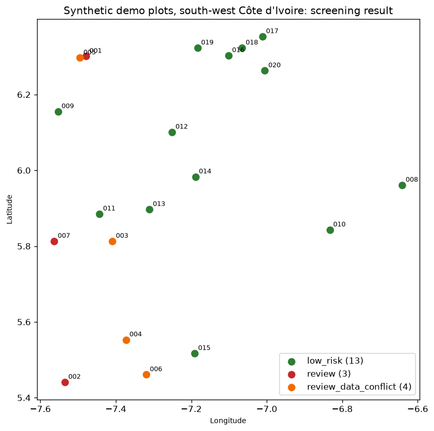

# EUDR Plot Screening Tool

Screens agricultural plots for **forest loss after 31 December 2020**, the EU Deforestation Regulation (EUDR) cut-off date, using only open satellite data.

> ⚠️ This is a **screening tool**, not a legal compliance determination. Plots flagged "review" need human inspection and supporting documentation.

## What it does

```
Plots (GeoJSON / CSV: points < 4 ha, polygons ≥ 4 ha)
        │
        ▼
Open data
  • JRC Global Forest Cover 2020      → was it forest at the cut-off?
  • Hansen Global Forest Change       → annual tree-cover loss after 2020
  • Sentinel-2 L2A (Earth Search/AWS) → visual before/after check, NDVI
        │
        ▼
Per-plot result: forest share 2020, loss area after 2020 (ha), flag (low risk / review)
        │
        ├── GeoJSON / CSV
        ├── PDF summary
        └── Web map (MapLibre) with before/after imagery
```

No Google Earth Engine account or paid API is required.

## Example

**Plot-level check:** a synthetic plot in south-west Côte d'Ivoire, forest in the 2019/20 dry season, cleared by 2025/26.



**Screening 20 synthetic plots** (~30 s): all 7 plots with post-2020 loss flagged, no false alarms among the other 13.



## Status

- [x] Project skeleton
- [x] Demo plots (20 synthetic plots, south-west Côte d'Ivoire, known expected answers)
- [x] Sentinel-2 before/after + NDVI (notebook 01)
- [x] Forest baseline + loss metrics per plot (notebook 02): 7/7 post-2020 loss plots flagged, 0/13 false alarms on the demo set
- [x] Web map (MapLibre): flags, per-plot reasons, Sentinel-2 before/after thumbnails, forest-loss overlay
- [x] PDF report: summary, results table, one sheet per flagged plot, method and limitations ([example](examples/eudr_screening_report.pdf))

## PDF report

```bash
python scripts/build_web.py --thumbs   # if not done yet
python scripts/make_report.py          # -> outputs/eudr_screening_report.pdf
```

## Web map

```bash
python scripts/build_web.py --thumbs   # screening + Sentinel-2 thumbnails -> web/data/
python -m http.server 8765 --directory web
# open http://localhost:8765
```

`web/` is a static site (no build step) and can be served from GitHub Pages.

## Flags

| Flag | Meaning |
|---|---|
| `low_risk` | No tree-cover loss after 2020 above the screening threshold (small losses are still listed in `flag_reason`) |
| `review` | Loss after 2020 **and** forest in 2020 per JRC: both datasets agree |
| `review_data_conflict` | Loss after 2020 but JRC mapped little or no forest (often tree crops / agroforestry): check imagery |

## Setup

```bash
conda env create -f environment.yml
conda activate eudr
jupyter lab
```

## Layout

```
data/       demo plots (inputs) and downloaded rasters (ignored by git)
notebooks/  step-by-step analysis notebooks
src/eudr_screen/  reusable code
web/        MapLibre demo map
outputs/    generated results (ignored by git)
docs/       notes and market research
```

## Data sources & licences

| Data | Provider | Licence |
|---|---|---|
| Sentinel-2 L2A | ESA Copernicus, via Element 84 Earth Search on AWS | Copernicus open data |
| Global Forest Cover 2020 (V4) | © European Union, EC Joint Research Centre | CC BY 4.0 |
| Global Forest Change v1.13 (2000–2025) | Hansen/UMD/Google/USGS/NASA | CC BY 4.0 |
| Web map background: Sentinel-2 cloudless 2020 | EOX IT Services GmbH | CC BY-NC-SA 4.0 (non-commercial) |
| Web map overlay: tree cover loss tiles | Global Forest Watch (Hansen/UMD data) | CC BY 4.0 |
| Web map background: OpenStreetMap | OpenStreetMap contributors | ODbL |

Demo plots are **synthetic** and do not represent real farms.
